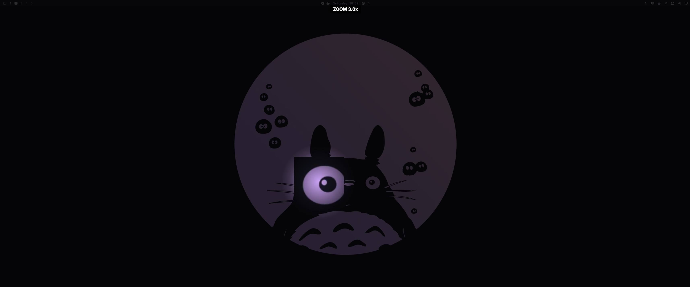

<div align="center">

# ZoomArchy

**Screenshot magnifier overlay for Omarchy on Wayland/Hyprland Linux**

*Focus on what matters — a fast, cursor-following zoom lens with a spotlight over your current screen.*

`Secure per-capture storage` · `Cursor lens & spotlight` · `Click/wheel zoom` · `Quickshell overlay`

<p>
  <a href="LICENSE"></a>
  <a href="https://github.com/vlaktaks/ZoomArchy/stargazers"></a>
  <a href="https://github.com/vlaktaks/ZoomArchy/network/members"></a>
  <a href="https://github.com/vlaktaks/ZoomArchy/issues"></a>
  <a href="https://github.com/vlaktaks/ZoomArchy/commits/main"></a>
</p>

<p>
  ZoomArchy is an Omarchy/Quickshell overlay plugin that captures the current screen on activation and presents a fullscreen magnifier lens with a radial spotlight, letting you zoom smoothly into details without leaving your Wayland/Hyprland session.
</p>



<p><sub>Static preview image — not a recorded runtime capture.</sub></p>

</div>

- **GitHub:** <https://github.com/vlaktaks/ZoomArchy>
- **Plugin ID:** `jp.zoomarchy`
- **Version:** `0.1.3`
- **Kind:** `overlay` (Quickshell/Omarchy plugin)
- **Entry point:** `Overlay.qml`

## Repository structure

This repository is a standalone Omarchy plugin repository: the **repository root is directly the installable plugin**. The following files are at the root level:

- `manifest.json` — plugin manifest
- `Overlay.qml` — overlay entrypoint (active implementation)

Other files at the root include documentation and repository metadata (e.g. `README.md`, `AGENTS.md`, `LICENSE`, `CHANGELOG.md`, `.gitignore`, `.gitattributes`), and project infrastructure in `.github/` (CI workflow and Dependabot configuration).

The canonical plugin ID is `jp.zoomarchy`. When installed, the plugin belongs in:

`~/.config/omarchy/plugins/jp.zoomarchy/`

## Current functionality

Based on the current implementation (`Overlay.qml`):

- **Activation:** summoned as the `jp.zoomarchy` overlay panel (for example via a manually configured shortcut such as `Super+Z`, or by direct summon command).
- **Screenshot capture:** when opened, validates `$XDG_RUNTIME_DIR`, creates a unique private temporary capture directory, and runs `grim` to save `capture.png` inside it for display in the overlay. The final runtime-directory and capture-file components are checked (without following final-component symlinks) for ownership, type, and permissions before a capture is accepted.
- **Magnifier lens:** a 200 × 200 px clipped, scaled view of the captured screenshot follows the cursor position.
- **Zoom behavior:**
  - Initial zoom level: `2.0`
  - Minimum zoom: `1.0`
  - Maximum zoom: `5.0`
  - **Left mouse click:** increase zoom level by `1.0` (up to maximum)
  - **Right mouse click:** decrease zoom level by `1.0` (down to minimum)
  - **Mouse wheel:** adjust zoom level in steps of `0.5` (clamped to minimum/maximum)
  - **Reopen while overlay is active:** zoom level is reset to `2.0`
- **Spotlight effect:** a radial spotlight/dimming overlay centered on the cursor is drawn over the screen.
- **Close:** `Escape` closes the overlay, clears the current screenshot path/state, and attempts best-effort cleanup of its own temporary screenshot files.

## How it works

1. When activated, ZoomArchy validates `$XDG_RUNTIME_DIR`, creates a unique private temporary capture directory inside it, and captures the current screen using `grim`.
2. After capture, ZoomArchy checks the final runtime-directory and capture-file components (without following final-component symlinks), including ownership, type, and permissions, before accepting the screenshot for display from that private temporary location.
3. A magnified lens and spotlight follow the cursor over that captured image.
4. Interactions (click/wheel/Escape) update zoom or close the overlay; on close, failure, or replacement, ZoomArchy attempts best-effort removal of its own temporary screenshot files/directories.

> **Note:** The magnifier operates on a screenshot taken at activation time (a static snapshot), not a continuously live-updating view of the desktop. If `$XDG_RUNTIME_DIR` is missing, invalid, or not safely usable, ZoomArchy does not fall back to `/tmp` and does not open the overlay with a captured screenshot.
>
> **Security note:** captures are stored in unique private capture directories under validated `$XDG_RUNTIME_DIR`. Final-component checks do not independently guarantee that every intermediate path component is safe, TOCTOU limitations remain, and screenshot permission hardening occurs after `grim` creates the file inside the private capture directory. Cleanup is best-effort and cannot be guaranteed after crashes or forced termination. There is no `/tmp` fallback.

## Requirements

- An Omarchy environment with Quickshell shell/plugin support
- `omarchy` CLI available in `PATH`
- `grim` (Wayland screenshot tool) available in `PATH`
- A Wayland/Hyprland-based Omarchy session (the plugin uses `Quickshell`, `Quickshell.Hyprland`, and `Quickshell.Wayland` imports)

## Installation

### Recommended: Omarchy plugin manager

Install directly from the GitHub repository:

```bash
omarchy plugin add https://github.com/vlaktaks/ZoomArchy.git --enable
```

This installs the plugin into `~/.config/omarchy/plugins/jp.zoomarchy/` (canonical plugin ID: `jp.zoomarchy`), validates it, and (with `--enable`) enables it. The repository root is the installable plugin root (`manifest.json` and `Overlay.qml` are at root level).

If you install without `--enable`, you can use the same repository URL and then enable the plugin explicitly:

```bash
omarchy plugin add https://github.com/vlaktaks/ZoomArchy.git
omarchy plugin enable jp.zoomarchy
```

After installation/enabling or after making changes, the Omarchy shell may need to rescan plugins. A locally tested way to rescan plugins is:

```bash
omarchy-shell shell rescanPlugins
```

### Local development / manual install

To test a local checkout as the installed plugin, install from the repository/plugin root (where `manifest.json` and `Overlay.qml` are located):

```bash
mkdir -p ~/.config/omarchy/plugins/jp.zoomarchy
install -m644 manifest.json ~/.config/omarchy/plugins/jp.zoomarchy/
install -m644 Overlay.qml ~/.config/omarchy/plugins/jp.zoomarchy/
omarchy plugin validate ~/.config/omarchy/plugins/jp.zoomarchy
omarchy plugin enable jp.zoomarchy
omarchy-shell shell rescanPlugins
```

Exclude local build artifacts, editor files, and other non-plugin files as appropriate for your checkout.

## Keyboard shortcut (Super+Z) — manual example

`Super+Z` can be used as a manual Hyprland keybinding to summon/toggle the `jp.zoomarchy` panel. **The plugin itself does not configure any Hyprland shortcut.** Hyprland configuration layouts vary between setups, so this repository does not automatically modify your Hyprland configuration.

If no binding is already configured for `jp.zoomarchy`, add the following to the appropriate bindings/config file for your setup (only once, and only if not already present):

```lua
o.bind("SUPER + Z", "ZoomArchy zoom", { panel = "jp.zoomarchy" })
```

After adding or changing bindings, reload your Hyprland/Omarchy configuration as required by your setup.

You can also activate the overlay without a keybinding:

```bash
omarchy-shell shell summon jp.zoomarchy '{}'
```

## Usage

- **Activate:** use your configured shortcut (e.g. manual `Super+Z` binding) or `omarchy-shell shell summon jp.zoomarchy '{}'`
- **Move mouse:** move the magnifier lens (200 × 200 px) and spotlight
- **Left mouse click:** increase zoom level by `1.0` (up to `5.0`)
- **Right mouse click:** decrease zoom level by `1.0` (down to `1.0`)
- **Mouse wheel:** adjust zoom level in steps of `0.5` (range `1.0`–`5.0`)
- **Escape:** close the overlay
- **Activate again while overlay is active:** zoom level is reset to `2.0`

## Enabling, disabling, updating, and uninstalling

Using the Omarchy plugin manager:

```bash
# Enable / disable
omarchy plugin enable jp.zoomarchy
omarchy plugin disable jp.zoomarchy

# Update (for git-managed installs)
omarchy plugin update jp.zoomarchy

# Remove/uninstall
omarchy plugin remove jp.zoomarchy
```

If you added a manual `Super+Z` Hyprland binding for `jp.zoomarchy`, remove it manually from your Hyprland configuration if you no longer want it.

## Configuration

The current `Overlay.qml` implementation does not read external runtime configuration files. Zoom levels, lens size, and visual behavior are defined in code (`Overlay.qml`).

## Troubleshooting

- **Plugin not found / cannot enable:** ensure the plugin is installed in `~/.config/omarchy/plugins/jp.zoomarchy/` and validate it:
  ```bash
  omarchy plugin validate ~/.config/omarchy/plugins/jp.zoomarchy
  omarchy plugin list
  ```
- **Super+Z does nothing:** `Super+Z` is only an example of a manual Hyprland binding; the plugin does not configure shortcuts automatically. Verify a binding for `jp.zoomarchy` exists in your active configuration, or test with `omarchy-shell shell summon jp.zoomarchy '{}'`.
- **No screenshot / overlay appears:** ensure `grim` is installed and available in `PATH`, and that `$XDG_RUNTIME_DIR` is available with safe private permissions. ZoomArchy stores each capture in a private unique temporary directory inside `$XDG_RUNTIME_DIR` and does not use an unsafe `/tmp` fallback.
- **After changes:** rescan plugins if needed. A locally tested command is:
  ```bash
  omarchy-shell shell rescanPlugins
  ```

## Development and testing

- **Project/agent instructions:** see [`AGENTS.md`](AGENTS.md) for architecture, conventions, validation, and contribution workflow details.
- **Plugin validation:**
  ```bash
  omarchy plugin validate .
  ```
- **Primary files:** `manifest.json`, `Overlay.qml`
- **Runtime verification:** activation, magnifier movement, zoom controls, Escape close, reopen/reset, and visual correctness on the target Omarchy/Hyprland desktop. Static validation does not replace runtime/visual verification.
- **CI:** GitHub Actions runs repository/plugin checks on `main` pushes and pull requests (`.github/workflows/ci.yml`). Omarchy-specific runtime validation remains a local requirement.
- **Dependency updates:** Dependabot is configured for GitHub Actions updates (`.github/dependabot.yml`).

## Contributing and pull requests

1. **Open a pull request against `main`.** Direct pushes and force pushes to `main` are blocked by repository rulesets.
2. **Wait for CI and reviews.** GitHub Actions runs the `CI` workflow (`.github/workflows/ci.yml`); the required status check is `Validate plugin files`. Automatic Copilot code review is enabled for PRs to the default branch (including draft PRs and new pushes) as configured in the repository ruleset, but automatic Copilot review is not the same as a separately enforced mandatory Copilot formal-approval merge gate unless explicitly configured and verified. The repository may also include CodeRabbit configuration (`.coderabbit.yaml`) for additional AI code review; CodeRabbit runs only when the official CodeRabbit GitHub App is installed/authorized for this repository and is **advisory only** (not a required approval/merge gate unless separately configured and verified).
3. **Obtain required approval and address feedback.** At least one approving review is required, stale approvals are dismissed on new pushes, approval of the most recent reviewable push is required, and all review conversations must be resolved. Address review feedback, especially for security-sensitive changes.
4. **Merge only when GitHub confirms all enforced requirements are met.** Required checks must pass (with the up-to-date branch/check policy enforced by the ruleset) before merging. Verify the current repository policy in GitHub if rulesets change.

## Known limitations

- Uses a screenshot captured at activation time (`grim` into a private unique temporary directory under `$XDG_RUNTIME_DIR`); the overlay does not update live as underlying windows change.
- Depends on `grim` and a compatible Omarchy/Quickshell Wayland environment.
- Behavior and appearance have been developed and adjusted primarily for the author's setup; results may vary across hardware, displays, scaling, themes, and compositor configurations.
- No text selection, OCR, or text extraction is implemented.
- Runtime zoom/appearance settings are currently hardcoded in `Overlay.qml`.

## License

GPL-3.0-or-later. See [`LICENSE`](LICENSE) for details.


## Historical implementation archive

A historical Qt Quick/qmake implementation is retained under `archive/legacy-qt-app/` for reference. It is not the current Omarchy/Quickshell plugin, is not part of plugin distribution, and its files are not installation dependencies for the current plugin (`manifest.json` and `Overlay.qml`).

## Project Status & Contributions

ZoomArchy currently works and has been optimized for my own Omarchy machine and setup. Your mileage may vary on other hardware or configurations.

**Contributions are welcome!** Feel free to open issues, suggest improvements, or submit pull requests.

Please note that this project is not currently intended to be validated or submitted through the official Omarchy Marketplace. Quite simply: **we don't care about Marketplace validation right now.**

The project is structured in a way that could make Marketplace submission possible in the future. However, pursuing that is not a current goal, and it has **zero priority**. The focus is on making ZoomArchy work well and keeping it useful.
